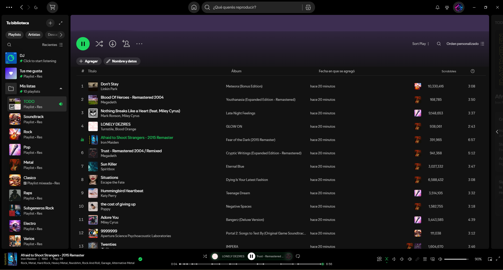
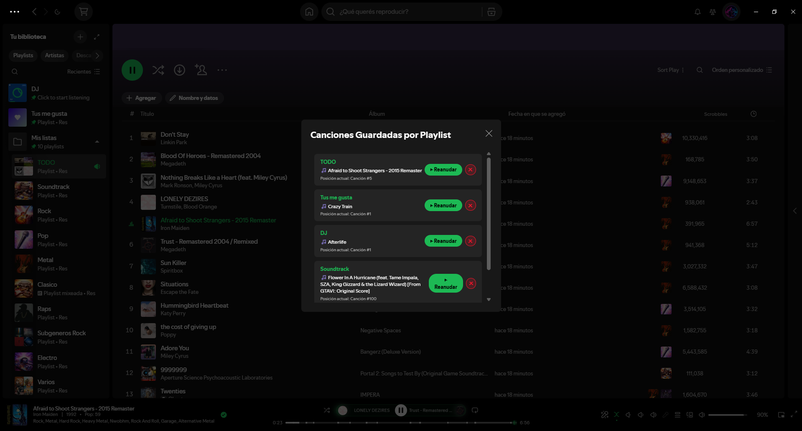
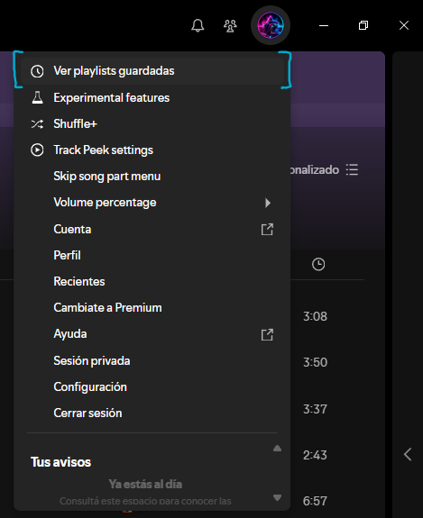
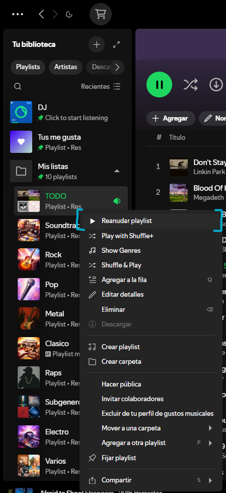

# 🎵 Resume Playlist for Spicetify

> Automatically remember and resume your playback position for any Spotify playlist right where you left off.

---

## 🌟 Features

- 🎧 **Automatic Progress Tracking**: Continuously saves your current track and progress in any playlist in real time.
- 🖱️ **Context Menu Action**: Right-click on any playlist to instantly "Resume playlist" / "Reanudar playlist".
- 📜 **Profile Menu Modal**: Access your saved history directly from Spotify's top-right profile dropdown.
- ❌ **Individual & Bulk Cache Management**: Delete specific saved positions or clear the entire history with a single click (includes confirmation prompts).
- 🌐 **Bi-lingual Support (i18n)**: Seamless auto-detection between **Spanish** (all `es-*` locales) and **English** (fallback for all other languages).
- 🔒 **Privacy First**: 100% client-side storage using native `localStorage`. No external servers or data tracking.

---

## 📸 Screenshots

<!-- Replace these placeholder URLs with your actual repository image paths -->
| Currently Playing Song Preview | Saved Playlist States |
| :---: | :---: |
|  |  |
| **Saved states menu location**<br> | **Resume option in the playlist context menu**<br> |

---

## 🚀 Installation

### Option 1: Spicetify Marketplace (Recommended)

1. Open **Spotify** and navigate to the **Marketplace** tab.
2. Search for `Resume Playlist`.
3. Click **Install**.

---

### Option 2: Manual Installation (CLI)

#### 1. Download the Extension

Download the `resume-playlist.js` file from the latest release or clone this repository:

```bash
git clone https://github.com/TuUsuario/resume-playlist.git
```

#### 2. Copy to Spicetify Extensions Directory

- **Windows**: `%appdata%\spicetify\Extensions\`
- **Linux**: `~/.config/spicetify/Extensions/`
- **macOS**: `~/.config/spicetify/Extensions/`

#### 3. Enable and Apply

Open your terminal/PowerShell and run:

```bash
spicetify config extensions resume-playlist.js
spicetify apply
```

---

## 📖 How to Use

1. **Listen to any playlist**: Play music normally from any playlist. The extension saves your progress automatically in the background.
2. **Resume a playlist**:
   - **Method A**: Right-click any playlist card or sidebar item and select **"Resume playlist"** (or *"Reanudar playlist"*).
   - **Method B**: Click your profile icon at the top-right corner of Spotify, select **"View saved playlists (Resume)"**, and click the **"▶ Resume"** button next to your desired playlist.
3. **Manage history**:
   - Open the **Saved Playlists Modal** from your profile menu.
   - Click the red **✕** button next to any entry to remove a specific saved position.
   - Click **"🗑️ Clear all saved history"** at the bottom to reset all stored positions.

---

## ⚠️ Notes

- **Queue Conflicts**: If you manually alter your queue or turn on *Shuffle*, Spotify's playback engine may adjust sequence priorities, but the extension will always target the exact track URI saved.
- **Removed Songs**: If a previously saved song was deleted from the playlist by its owner, the extension falls back to the first song in the playlist.
- **Deleted Playlists**: If a playlist with a saved position is deleted, its saved entry will remain in the history. You can remove this entry manually from the Saved Playlists Modal.

---

## 📄 License

This project is licensed under the [MIT License](LICENSE).

---
---

# 🎵 Resume Playlist para Spicetify

> Recuerda y reanuda automáticamente tu posición de reproducción en cualquier playlist de Spotify, justo donde la dejaste.

---

## 🌟 Características

- 🎧 **Seguimiento automático del progreso**: Guarda continuamente la canción actual y el progreso de reproducción en cualquier playlist, en tiempo real.
- 🖱️ **Acción en el menú contextual**: Haz clic derecho en cualquier playlist para seleccionar instantáneamente «Reanudar playlist».
- 📜 **Ventana modal del menú de perfil**: Accede directamente a tu historial guardado desde el menú desplegable del perfil, ubicado en la esquina superior derecha de Spotify.
- ❌ **Gestión individual y masiva de la caché**: Elimina posiciones guardadas específicas o borra todo el historial con un solo clic (incluye mensajes de confirmación).
- 🌐 **Soporte bilingüe (i18n)**: Detección automática entre **español** (todas las configuraciones regionales `es-*`) e **inglés** (idioma predeterminado para el resto).
- 🔒 **Privacidad ante todo**: Almacenamiento 100 % del lado del cliente mediante `localStorage` nativo. No utiliza servidores externos ni realiza seguimiento de datos.

---

## 📸 Capturas de pantalla

<!-- Reemplaza estas URL de ejemplo con las rutas reales de las imágenes del repositorio -->
| Vista previa de la canción en reproducción | Lista de estados guardados |
| :---: | :---: |
|  |  |
| **Ubicación del menú de estados guardados**<br> | **Opción para reanudar en el menú contextual de la playlist**<br> |

---

## 🚀 Instalación

### Opción 1: Spicetify Marketplace (recomendada)

1. Abre **Spotify** y dirígete a la pestaña **Marketplace**.
2. Busca `Resume Playlist`.
3. Haz clic en **Instalar**.

---

### Opción 2: Instalación manual (CLI)

#### 1. Descarga la extensión

Descarga el archivo `resume-playlist.js` de la última versión publicada o clona este repositorio:

```bash
git clone https://github.com/TuUsuario/resume-playlist.git
```

#### 2. Copia el archivo al directorio de extensiones de Spicetify

- **Windows**: `%appdata%\spicetify\Extensions\`
- **Linux**: `~/.config/spicetify/Extensions/`
- **macOS**: `~/.config/spicetify/Extensions/`

#### 3. Habilita y aplica la extensión

Abre tu terminal o PowerShell y ejecuta:

```bash
spicetify config extensions resume-playlist.js
spicetify apply
```

---

## 📖 Cómo utilizarla

1. **Escucha cualquier playlist**: Reproduce música normalmente desde cualquier playlist. La extensión guardará tu progreso automáticamente en segundo plano.
2. **Reanuda una playlist**:
   - **Método A**: Haz clic derecho en cualquier tarjeta de playlist o elemento de la barra lateral y selecciona **«Reanudar playlist»**.
   - **Método B**: Haz clic en el icono de tu perfil, ubicado en la esquina superior derecha de Spotify, selecciona **«Ver playlists guardadas (Resume)»** y haz clic en el botón **«▶ Reanudar»** junto a la playlist deseada.
3. **Gestiona el historial**:
   - Abre la **ventana modal de playlists guardadas** desde el menú de tu perfil.
   - Haz clic en el botón rojo **✕** junto a cualquier entrada para eliminar una posición guardada específica.
   - Haz clic en **«🗑️ Borrar todo el historial guardado»** en la parte inferior para restablecer todas las posiciones almacenadas.

---

## ⚠️ Notas

- **Conflictos con la cola**: Si modificas manualmente la cola o activas el modo *Aleatorio*, el motor de reproducción de Spotify puede ajustar las prioridades de la secuencia, pero la extensión siempre intentará reproducir la URI exacta de la canción guardada.
- **Canciones eliminadas**: Si una canción guardada anteriormente fue eliminada de la playlist por su propietario, la extensión reproducirá la primera canción de la playlist como alternativa.
- **Playlists eliminadas**: Si se elimina una playlist que tiene una posición guardada, su registro permanecerá en el historial. Puedes eliminarlo manualmente desde la ventana modal de playlists guardadas.

---

## 📄 Licencia

Este proyecto está bajo la [Licencia MIT](LICENSE).
